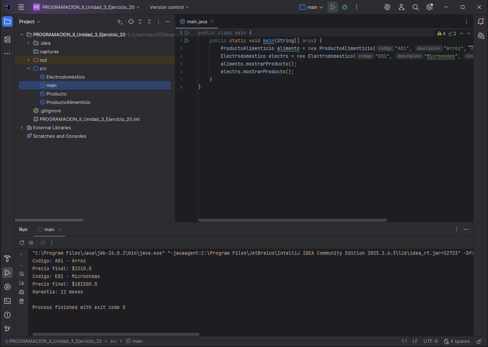

# PROGRAMACIÓN II — Unidad 3, Ejercicio 20: El Control de Asistencia a un Evento Exclusivo

Trabajo práctico de Programación II. Este repositorio contiene la resolución en Java del ejercicio 20 de la Unidad 3.

## Consigna

#### Contexto

El control de capacidad máxima de un evento privado se gestiona mediante un contador interno protegido. Ningún agente externo puede alterar el número de asistentes confirmados de forma directa, garantizando un registro exacto del aforo.

#### Consigna

Implementar una clase en Java que controle el aforo de un evento, encapsulando el número de asistentes actuales y aplicando restricciones de capacidad máxima.

#### Desarrollo requerido

- Crear la clase ControlAforo con atributos privados para la capacidad máxima permitida y el contador de asistentes actuales.
- Desarrollar un método público boolean registrarIngreso() que verifique si hay espacio disponible antes de incrementar el contador interno.
- Crear un método público registrarSalida() que decremente el contador asegurando que nunca sea menor a cero.
- En el método main, instanciar el control de aforo, simular ingresos masivos que superen el límite del evento, y mostrar los resultados de la admisión por consola.

## Estructura del repositorio

```
PROGRAMACION_II_Unidad_3_Ejercicio_20/
├── README.md
├── capturas/
│   └── consola.png
└── src/
    ├── Electrodomestico.java
    ├── main.java   # clase con el método main
    ├── Producto.java
    └── ProductoAlimenticio.java
```

## Funcionamiento y lógica

El ejercicio aplica **herencia y sobrescritura** para calcular el precio final de distintos tipos de producto.

### `Producto` (clase base)

Tiene los atributos `protected` `codigo`, `descripcion` y `costoBase`.

- **`calcularPrecioFinal()`:** en la clase base devuelve el costo sin cambios.
- **`mostrarProducto()`:** imprime código, descripción y precio final. Usa `calcularPrecioFinal()`, así cada subclase muestra su propio precio.

### `ProductoAlimenticio`

Agrega un `porcentajeImpuesto` y sobrescribe `calcularPrecioFinal()` para sumarle ese porcentaje al costo.

### `Electrodomestico`

Agrega los meses de `garantiaMeses`. Sobrescribe `calcularPrecioFinal()` para sumar el 21 % de IVA, y `mostrarProducto()` para agregar la garantía.

### `main`

Muestra dos productos:

- **Arroz:** costo $2000 con 10.5 % de impuesto → **$2210**.
- **Microondas:** costo $150000 con 21 % → **$181500**, con 12 meses de garantía.

## Ejecución

Captura de la consola de IntelliJ IDEA ejecutando el programa:



Salida obtenida:

```
Codigo: A01 - Arroz
Precio final: $2210.0
Codigo: E01 - Microondas
Precio final: $181500.0
Garantia: 12 meses
```
